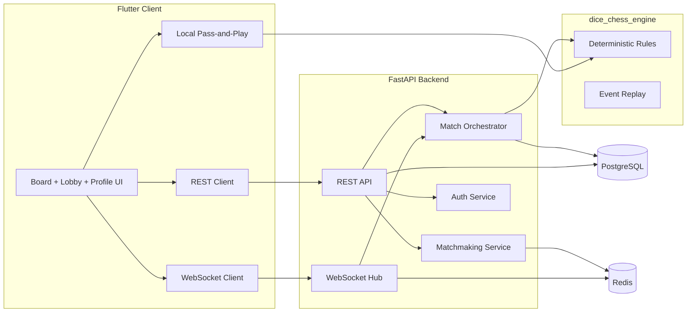

# Architecture

## Core principles

- Server-authoritative online game state.
- Deterministic engine as single source of truth for rule validation.
- Event log + snapshots for resync and replay.
- Shared protocol contract in `protocol.md`.
